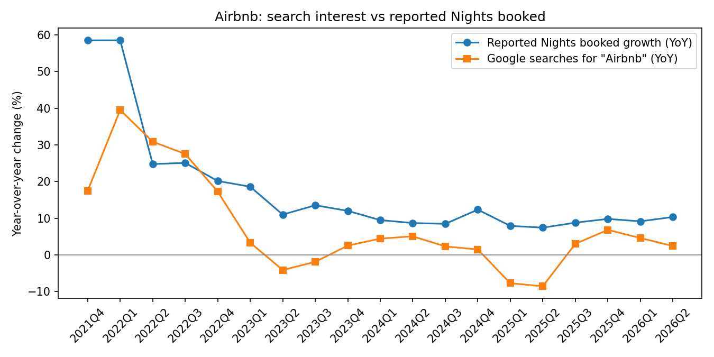
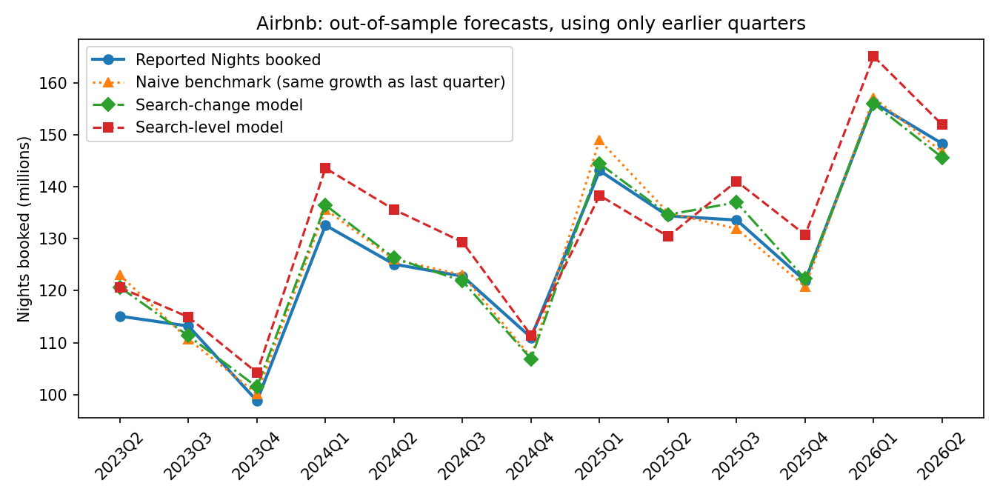

# Airbnb (ABNB): Google searches vs nights booked

KPI: nights and experiences booked (renamed "nights and seats booked" in 2025), 23 quarters (Q4 2020 to Q2 2026), scraped from Airbnb's SEC earnings filings by `src/scrape_kpi.py`. Every row in [`kpi.csv`](kpi.csv) links to its filing and the exact text matched.

## Results

**Short answer: only on average. Search beat the benchmark overall, but in fewer than half the quarters, and the edge disappears without one quarter.**

| | Result |
|---|---|
| Quarters compared (YoY growth) | 19 (Q4 2021 to Q2 2026) |
| Correlation, search growth vs booking growth | 0.76 |
| Out-of-sample quarters tested | 13 |
| Error, naive benchmark (same growth as last quarter) | 2.44M nights |
| Error, search-change model | 2.19M nights (10% better) |
| Error, search-level model | 6.06M nights (149% worse) |
| Search-change model calling acceleration vs deceleration | 8 of 13 quarters (62%) |
| Search-change model closer than the benchmark | 6 of 13 quarters |
| Search-change model without its single best quarter | 5% worse than the benchmark |

**What happened:** booking growth has been fairly steady since 2023, between roughly 7% and 14% a year, so there were few big turns to call. The search-change model's 10% edge comes mainly from two quarters where the benchmark carried forward an unusual number. In Q2 2023 it assumed the 18.6% growth of Q1 would continue (actual: 11.0%), and in Q1 2025 it carried forward Q4 2024's 12.3% (actual: 7.9%, partly a calendar effect, since Q1 2024 had the extra Leap Day). Search pointed lower both times. In quiet quarters it did no better than the benchmark, and in Q3 2025 it was clearly worse (11.6% predicted vs 8.8% actual). The search-level model failed throughout.

**Why it only half works here:** the idea still makes sense. A trip usually starts with a search, so search interest should be close to the moment of demand. In practice, Airbnb's growth has been too steady for that to matter much, and search mostly helped when last quarter's growth was a poor guide for calendar reasons.

**How much to trust it:** not much. The edge depends on a single quarter (without Q1 2025, search does 5% worse than the benchmark), and 13 tested quarters is a small sample. The 0.76 correlation is also flattered by the post-pandemic rebound in 2021 and 2022, when both series swung far more than they do today.

## Prediction for Q3 2026

Made before Airbnb reports Q3 2026. The 2 October call is kept as recorded; the 16 October row is a re-run after switching to scraped KPI data and full-history monthly search data.

| Made on | Naive benchmark | Search-change model | Search-level model (not trusted given its record) | Search interest YoY |
|---|---|---|---|---|
| 2 October 2026 | 147.4M (10.3%) | 142.0M (6.3%) | 140.1M (4.9%) | -12.6% |
| 16 October 2026 | 147.4M (10.3%) | 140.6M (5.2%) | 133.8M (0.2%) | -11.7% |
| Reported | _fill in after the release_ | | | |

My original call was about **142M**, a slowdown to roughly 6% growth, and the re-run points the same way (140.6M). Given how weak the evidence above is, a result close to the benchmark's 147M would not be surprising, and that would count against the search signal.

One risk to this call: Google search volumes overall may be shifting as more people get answers from AI assistants and AI search summaries. A broad decline in searching would show up as weaker search interest without any real drop in travel demand.

## Next steps

- **Region-level search:** worldwide search mixes Airbnb's mature North American market with fast-growing regions. Searching by country could separate the two.
- **Travel-specific terms:** searches like "Airbnb Paris" or "vacation rental" may track booking intent more closely than the brand name alone.
- **Wait for more quarters:** each new quarter adds one more test, and the scraper now collects it automatically.
