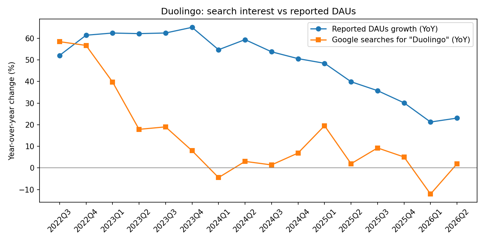
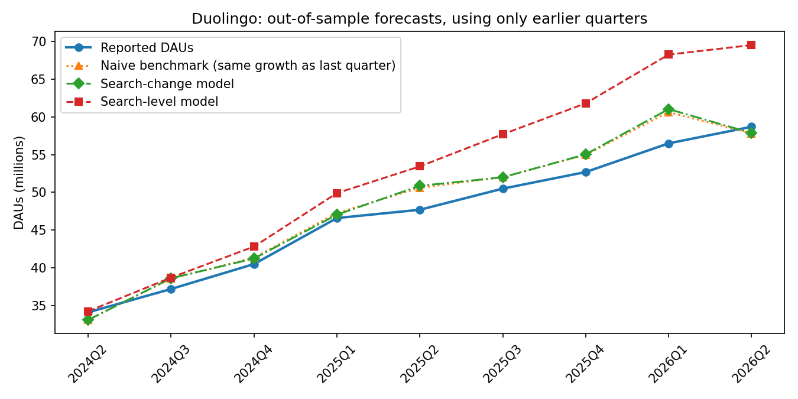

# Duolingo (DUOL): Google searches vs daily active users

KPI: daily active users (DAUs), 20 quarters (Q3 2021 to Q2 2026), scraped from Duolingo's SEC earnings filings by `src/scrape_kpi.py`. Every row in [`kpi.csv`](kpi.csv) links to its filing and the exact text matched.

I hold Duolingo in my own portfolio, so this was also a way to check the user growth story with data instead of waiting for the shareholder letter.

## Results

**Short answer: yes, but only slightly. Search nudged forecasts in the right direction in most quarters, by small amounts, and this result reversed an earlier one.**

| | Result |
|---|---|
| Quarters compared (YoY growth) | 16 (Q3 2022 to Q2 2026) |
| Correlation, search growth vs DAU growth | 0.47 |
| Out-of-sample quarters tested | 10 |
| Error, naive benchmark (same growth as last quarter) | 1.77M DAUs |
| Error, search-change model | 1.57M DAUs (11% better) |
| Error, search-level model | 5.58M DAUs (215% worse) |
| Search-change model calling acceleration vs deceleration | 7 of 10 quarters (70%) |
| Search-change model closer than the benchmark | 7 of 10 quarters |
| Search-change model without its single best quarter | 7% better than the benchmark |

**What happened:** DAU growth slowed steadily over the test period, from around 55% a year in early 2024 to around 21% to 23% in 2026. Search growth slowed too, and the search-change model used that to shade its forecasts a little below the benchmark. It was closer in 7 of 10 quarters and kept its edge with its best quarter removed. The improvements were small, though: about 0.2M DAUs per quarter on a base of roughly 50M. The search-level model failed throughout, because it learned the relationship from the early high-growth years and kept predicting growth that never came back.

**Why it works here, a little:** search interest mostly reflects people discovering Duolingo, not existing users opening the app. So it can't explain how users nearly tripled from Q2 2023 (21.4M) to Q2 2026 (58.7M) while search interest grew far less. That growth looks driven by retention and engagement (streaks, notifications, gamification). What search can do is pick up the slowdown in new-user interest, and that seems to be the part of DAU growth it helped forecast. This is a hypothesis the data can't prove on its own.

**How much to trust it:** cautiously. An earlier version of this analysis (hand-entered KPIs with a two-quarter gap, and 5 years of weekly search data) found search did 4% worse than the benchmark over 7 quarters. Filling the gap and using the full search history flipped that to 11% better over 10 quarters. A result that changes sign when the data changes is weak evidence either way, even though the current version is consistent across quarters.

## Prediction for Q3 2026

Made before Duolingo reports Q3 2026. The 2 October call is kept as recorded; later rows are re-runs after data changes (14 October: scraped KPI data; 16 October: full-history monthly search data).

| Made on | Naive benchmark | Search-change model | Search-level model (not trusted given its record) | Search interest YoY |
|---|---|---|---|---|
| 2 October 2026 | 62.1M (23.1%) | 62.0M (22.9%) | 69.4M (37.4%) | -12.8% |
| 14 October 2026 | 62.1M (23.1%) | 61.7M (22.2%) | 69.3M (37.2%) | -12.8% |
| 16 October 2026 | 62.1M (23.1%) | 61.1M (20.9%) | 70.6M (39.7%) | -12.7% |
| Reported | _fill in after the release_ | | | |

My original call was about **62M**, and the current search-change model says **61.1M**. Both sit close to the benchmark, so the real test is whether the small downward nudge from search lands closer than simply carrying Q2's growth forward.

## Next steps

- **Signals closer to the product:** app store rankings or download estimates, and Wikipedia page views, may track usage better than search.
- **Country-level search:** worldwide search mixes mature and fast-growing markets. Checking, say, the US against India could show where search still works.
- **Explain retention directly:** compare DAU/MAU (the share of monthly users who show up daily) with search, to test the retention story above.
